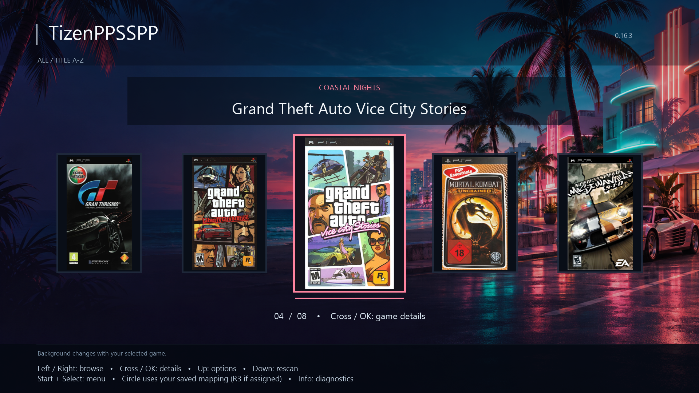

# TizenPPSSPP

PlayStation Portable emulation for Samsung Tizen TVs, powered by [PPSSPP](https://www.ppsspp.org/).

## Current look

*1920 × 1080 desktop render of the current native app layout, showing Grand Theft Auto: Vice City Stories. This is a UI preview, not a direct TV capture; font rendering and compositing may differ on the TV. November 2026.*

## Development status

The native TV app is running with a cover carousel, game-specific backgrounds, controller settings and per-game emulation options. Significant performance tuning remains: game speed and compatibility vary, and this preview does not demonstrate full-speed GTA gameplay.

Source code, installation instructions and release packages will be added when ready.

An independent community project; not affiliated with Samsung, Sony or the PPSSPP team. Game artwork shown belongs to its respective owners; no games are provided here.
