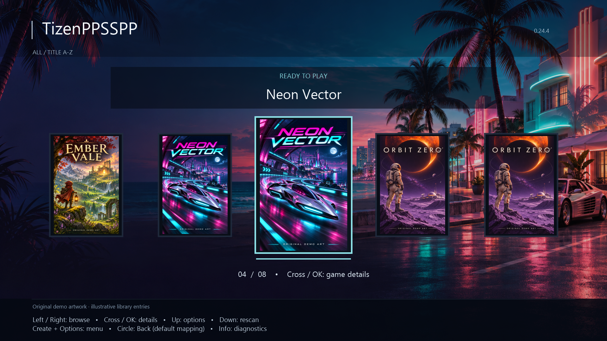
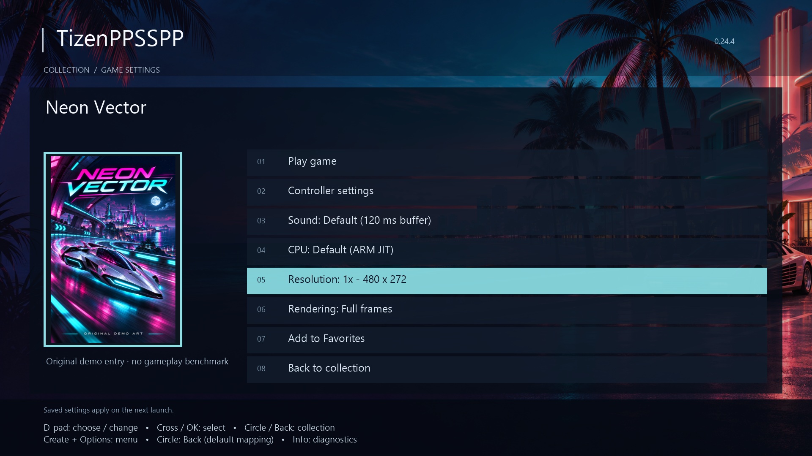
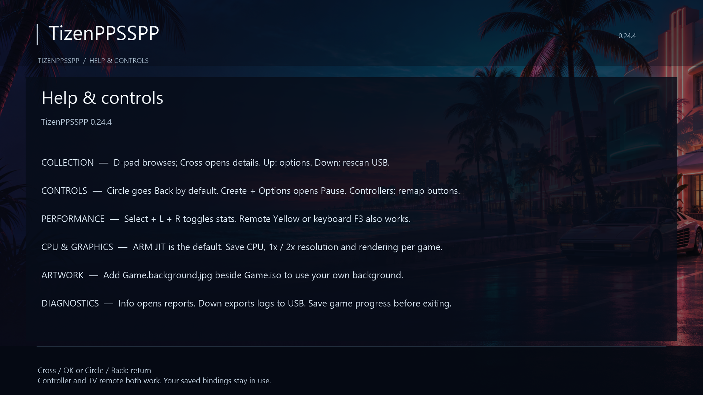

# TizenPPSSPP 0.24.4

PSP emulation powered by PPSSPP. Browse your PSP collection with large cover artwork, per-game backgrounds and a controller-friendly details screen.

*Current development interface, rendered from app layout code with sample artwork. This is a desktop preview, not a TV capture; your own games and covers populate the library. [Preview details](docs/showcase/README.md).*

[Download current source](https://github.com/DadeRushmore/TizenPPSSPP/archive/refs/heads/main.zip) · [Releases](https://github.com/DadeRushmore/TizenPPSSPP/releases) · [Build guide](BUILD.md)

## More views

**Per-game settings**

**Help and controls**

## PS5 controls

The native PS5 reader uses distinct Circle and Triangle inputs. **Circle goes Back by default; R3 is not required as a workaround.** Create + Options opens the menu. Custom button assignments remain available in Controllers. The old 0.16.3 preview and its R3 hint have been replaced. Physical TV verification of the new mapper remains pending; see [controller validation notes](docs/PS5-CONTROLLERS-2026-11-14.md).

## Download and installation status

**Public source edition.** This repository builds on the curated development baseline frozen on 16 November 2026 and published on 22 November 2026. The main branch also includes the interface previews and documentation corrections shown here. The full source is browsable here: clone the repository or use **Code → Download ZIP**. There is no separate missing source download.

**This version does not include an installable TPK and is not an out-of-the-box build.** Native executables, private packages and selected prebuilt runtime assets are omitted. See [BUILD.md](BUILD.md) for the source layout and prerequisites, and [DISTRIBUTION.md](DISTRIBUTION.md) for the remaining binary-release work.

## Source layout

| Material | Location |
|---|---|
| TV application | `app/` |
| Native integration/build tooling | `native/core-build/ and native/libretro-bridge/` |
| Vendored emulator source | `vendor/ppsspp/` |
| Exact file hashes | [SOURCE-MANIFEST.json](SOURCE-MANIFEST.json) |
| Exclusions and release metadata | [PUBLIC-SOURCE.json](PUBLIC-SOURCE.json) |

## Verification

With Python 3 installed, run `python tools/verify-public-source.py` from the repository root. This checks the file inventory, SHA-256 hashes, credential patterns and compiled executable signatures. It does not compile the emulator or establish TV compatibility. See [VALIDATION.md](VALIDATION.md).

## Licensing and artwork

PPSSPP GPL-2.0-or-later; frontend GPL-2.0; FFmpeg LGPL-2.1-or-later and vendored dependencies under their retained notices.

The top-level LICENSE covers the project code; third-party components retain their individual licenses. See [THIRD-PARTY-NOTICES.md](THIRD-PARTY-NOTICES.md). No commercial game files, retail BIOS images, private signing keys or device pairing files are supplied. The README previews use fictional demo covers; see [preview and artwork notes](docs/showcase/README.md). Application placeholder artwork is generated by [render-public-art.py](render-public-art.py); its inventory is [public-art.json](public-art.json). Vendored upstream source assets retain their own notices.

Independent community project; not affiliated with Samsung, Sony, Nintendo or the upstream emulator teams. No new TV gameplay or compatibility claim is made by this source publication.
